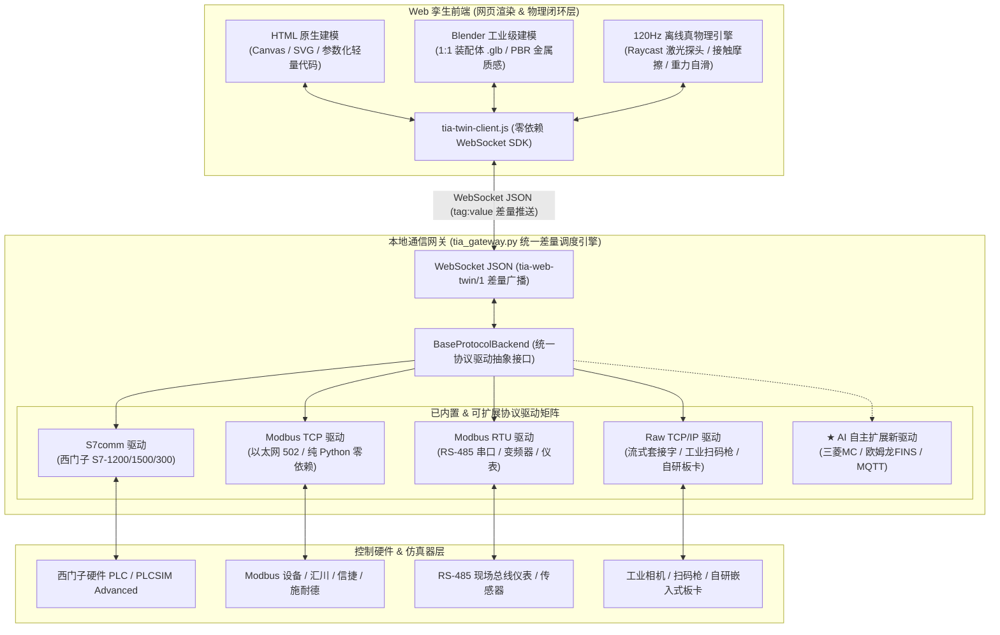

<div align="center">

# 🏭 工业产线 Web 数字孪生 & 多协议控制协同平台
### Industrial Web Digital Twin & Multi-Protocol Control Platform

> **双建模流派**：【HTML 原生建模（纯代码秒开）】与【Blender 工业高保真建模（全面替代 NX/SolidWorks）】  
> **多工业协议**：原生支持西门子 S7 (S7comm)、Modbus TCP、Modbus RTU (RS-485)、Raw TCP/IP 及 AI 依规自主扩展新协议驱动  
> *A standardized Industrial Digital Twin & Multi-Protocol Gateway bridging Web 3D/2D Interfaces and Physical PLCs / Simulators.*

[](LICENSE)
[](https://python.org)
[](https://support.industry.siemens.com)
[](references/protocol-extension-guide.md)
[](references/blender-industrial-modeling.md)
[](references/deployment.md)
[](references/deployment.md)

<p align="center">
  <a href="#-核心四大跨越">核心跨越</a> •
  <a href="#-统一系统架构">系统架构</a> •
  <a href="#-建模双流派html-原生-vs-blender-高保真">建模双流派</a> •
  <a href="#-多工业协议全互联--ai-扩展">多工业协议</a> •
  <a href="#-快速开始">快速开始</a> •
  <a href="#-完整交付体系">交付规范</a> •
  <a href="#-避坑指南">避坑指南</a>
</p>

</div>

---

## 🌟 核心四大跨越

让 AI 生产与前端工程中的数字孪生不再是“孤立展示的假动画”，而是**严格遵循工业 I/O 信号契约、具备真实物理反馈的闭环被控对象**：

| 维度 | 传统 Web 3D 页面 / 玩具动画 | 本方案工业级数字孪生体系 |
| :--- | :--- | :--- |
| **视觉呈现** | 纠结 2D 还是 3D，AI 手写粗糙几何体积木块 | **【HTML 原生建模】与【Blender 工业建模】双轨并行**，全面替代重型 CAD (NX/SolidWorks)，原生 PBR 质感 |
| **底层通信** | 绑定单一厂商或重型 OPC UA，缺少现场轻量支持 | **原生多协议（S7comm / Modbus TCP / Modbus RTU / TCP-IP）**，协议解耦，AI 依规自主开发新驱动 |
| **控制机理** | 前端写死常转动画，虚假运转，无反馈 | **动静分离，纯信号驱动**：PLC 输出 1 则动、0 则停；物料到位自动向 PLC 回写虚拟传感器信号 |
| **交付门槛** | 依赖复杂 Node.js/Python 编译与环境变量 | **内置 ~20MB 绿色便携 Python 运行时**，Windows 11 24H2 零拦截，桌面图标一键直达，零敲命令行 |

---

## 🏗️ 统一系统架构



---

## 🎨 建模双流派：HTML 原生 vs Blender 高保真

彻底取消模糊的“2D 还是 3D”概念区分，以**工程资产生产链路**作为核心二选一决策：

```text
用户需求输入 ──► 需要建模时明确决策：
                   ├──► 选项 A：【HTML 原生建模】 (纯代码秒级生成，零外部资产，最适合快速原型)
                   └──► 选项 B：【Blender 工业建模】(替代重型 CAD，高保真 PBR .glb 资产，最适合现场交付)
```

### 1. HTML 原生建模 (`--mode html`)
* **适用场景**：快速原型验证、轻量教学调试、无 3D 美术资产的纯代码极速开箱；
* **技术特性**：AI 直接在前端通过 Canvas / SVG / 参数化 3D 代码生成；
* **优势**：零外部模型依赖，无需安装任何 3D 软件，工程文件体积小（< 2MB），生成速度最快。

### 2. Blender 工业级建模 (`--mode blender` · 替代 NX/SolidWorks)
* **适用场景**：追求 100% 工业级实物真实度、高质感展台汇报、真实机械产线数字孪生；
* **为什么彻底替代重型 CAD**：传统 CAD 导出的模型面数动辄数百万面、无法直接在 Web 渲染且丢失装配层级；Blender 支持使用 `CAD Sketcher` 草图约束，原生导出轻量 glTF 2.0 (`.glb`)，面数精准控制在 10~30 万面，原生 PBR 金属度/粗糙度质感；
* **规范文档**：详见 [Blender 工业产线建模全流程指南](references/blender-industrial-modeling.md)。
* **配套无依赖自检工具**：
  ```bash
  # 自动分析模型节点树、校验尺寸比例、自动生成 twin.manifest.json 中的 bindings 映射：
  python scripts/inspect_glb.py assets/models/my_line.glb
  ```

---

## 🌐 多工业协议全互联 & AI 依规自主扩展

前端 Web 孪生页面与底层工业通信协议**完全解耦**。前端只消费标准 WebSocket JSON，底层无论换成何种协议，页面逻辑与 3D 模型完全无需二次开发！

### 1. 原生内置协议矩阵
* **西门子 S7comm (`protocol: "s7"`)**：底层基于 ISO-on-TCP (Port 102)，支持 S7-1200 / S7-1500 / S7-300 / S7-400 及 PLCSIM Advanced：
  - **全存储区穿透**：不仅支持跨非优化数据块（`DB1`, `DB2`...），更原生支持直接读写**物理输入 I 区（%I）**、**物理输出 Q 区（%Q）**、**位存储器 M 区（%M）**；
  - **工业模拟量通道**：支持 16 位模拟量通道（`IW64`, `QW64`, `MW10`，标准 `0~27648` 工程量输入输出）与 32 位工程浮点量（`MD20`, `DBD4`，单精度 IEEE 754 Real 流量/温度/压力瞬时值）；
  - **网关自动分组连续读取**：底层基于 Snap7 `read_area`，按 `(area, db)` 自动合并连续块，降低通讯网络往返延迟，保障 10~30Hz 工业级高频刷新。
* **Modbus TCP (`protocol: "modbus-tcp"`)**：采用**纯 Python 异步实现**，零第三方库依赖，开箱即用支持 `0x/1x/3x/4x` 线圈与寄存器；
* **Modbus RTU / RS-485 (`protocol: "modbus-rtu"`)**：支持串口通信（波特率、从机站号、奇偶校验），连接工业变频器、温控仪表；
* **Raw TCP/IP Socket (`protocol: "tcp-raw"`)**：支持原始二进制字节流与定界符切包，直接连通工业扫码枪、视觉相机与单片机。

### 2. AI 依规自主开发扩展新协议 (10 分钟交付)
当遇到**三菱 MC 协议、欧姆龙 FINS、MQTT、Beckhoff ADS 或专有报文**时，指导 AI Agent 严格按照 [`references/protocol-extension-guide.md`](references/protocol-extension-guide.md) 的统一抽象基类 `BaseProtocolBackend`：
1. 继承驱动基类，实现 `ensure_connected`、`read_all`、`write`、`status` 四大标准异步接口；
2. 在网关工厂函数中注册新协议；
3. **前端数字孪生与操作台即刻与新硬件连通**！

---

## ⚡ 快速开始

### 1. 开发者 / AI Agent 一键脚手架

在工程根目录执行脚手架（零终端门槛交付）：

```bash
# 模式 A：Blender 工业级高保真 3D 资产建模 (最推荐交付)
python scripts/make_project.py --out ./my-sorting-line --mode blender

# 模式 B：HTML 原生纯代码建模 (极速原型，零外部文件)
python scripts/make_project.py --out ./my-sorting-line --mode html
```

### 2. 最终用户：3 种免终端启动方式（无需安装 Python）

交付给最终用户的工程目录**默认自带 20MB 绿色便携 Python 运行时**与纯 7-bit ASCII 启动器（100% 兼容 Windows 11 24H2）：

| 启动方式 | 适用场景 | 操作步骤 |
| :--- | :--- | :--- |
| **方式 1：桌面图标一键直达** | **日常最推荐**，连目录都不用进 | 首次双击运行 `make_shortcut.bat` 在桌面生成图标，后续在桌面直接双击秒开 |
| **方式 2：文件夹双击启动** | 在工程文件夹内直接调试 | 双击 `start.bat`，优先直调自带绿色环境、启动网关并自动弹出默认浏览器 |
| **方式 3：后台静默常驻** | 车间平板跨设备无线访问 | 双击 `start_silent.bat`（无黑框常驻后台），用局域网设备输入网址直接访问；关闭时双击 `stop.bat` |

---

## 📦 统一工业 I/O 契约体系（“五合一”）

1. **`twin.manifest.json`（统一信号契约）**：跨平台唯一真相源，声明变量 ID、寻址地址（S7 DB 地址 / Modbus 寄存器 / TCP 偏移）、数据类型与读写权限；
2. **`TwinIO.scl`（博途非优化 DB 源码）**：由脚手架根据 manifest 自动生成，声明 `{ S7_Optimized_Access := 'FALSE' }`，在 TIA Portal 中一键生成 DB1；
3. **`TwinDemoLogic.scl`（配套闭环控制逻辑）**：与 DB 同步生成，内置启停自锁、PE1 光电触发推料、计数与复位。在博途 OB1 中插入一行 `"TwinDemoLogic"();` 即可 1 分钟完成活体闭环联调；
4. **`tia-twin-client.js`（零依赖前端客户端）**：网页直接引入，内置心跳保活、RTT 延迟计算、离线 Mock 切换及 50ms/100ms 动态扫描节拍切换；
5. **`tia_gateway.py`（多协议自适应网关）**：采用高效差量广播引擎，支持运行时热切换目标设备与协议。

---

## 📁 目录结构

```text
siemens-s7-web-twin/
├── SKILL.md                          # AI Agent Skill 核心规范、18 大硬性红线与标准 SOP
├── README.md                         # 项目核心说明与设计指南
├── scripts/
│   ├── make_project.py              # 一键脚手架：自动装配工程、内置便携运行时与 models/ 目录
│   ├── inspect_glb.py               # 零依赖 3D 资产 (Blender/CAD) 节点解析与 bindings 自动生成工具
│   ├── tia_gateway.py               # 多协议通用高性能通信网关 (S7 / Modbus / Raw TCP / AI 扩展)
│   ├── generate_scl.py              # 从 manifest 一键生成博途 DB 与控制逻辑 SCL 外部源文件
│   ├── validate_manifest.py         # 多协议信号清单语法校验与地址对齐检测
│   ├── run_twin.py                  # 服务管理与浏览器自动唤起启动器
│   ├── start.bat                    # Windows 极简启动器 (优先调用 ./runtime/ 绿色运行环境)
│   ├── make_shortcut.bat            # 原生 PowerShell 桌面快捷方式生成器
│   ├── start_silent.bat             # 后台静默启动器 (PowerShell 无黑窗静默模式)
│   ├── stop.bat                     # 后台服务一键终止脚本
│   ├── start_twin.bat / .sh         # 跨平台兼容启动脚本 (Win / Linux)
│   ├── start_twin.desktop           # Linux 桌面图标双击启动入口
│   ├── build_exe.bat                # Windows PyInstaller 打包脚本
│   ├── desktop_app.py               # 独立桌面端控制入口
│   └── requirements.txt             # Python 依赖清单
├── assets/
│   ├── runtime/
│   │   ├── portable-runtime.zip     # 内置官方免安装极简 Python 3.11 运行时 (含 snap7/websockets)
│   │   └── tia-twin-client.js       # 前端零依赖标准客户端 SDK
│   ├── template/                    # HTML 原生纯代码建模模板工程
│   ├── three-demo/                  # Blender 工业建模 WebGL 模板工程
│   │   ├── index.html / app.js / styles.css
│   │   └── vendor/                  # 本地离线 Three.js 核心库 (含零依赖 GLTFLoader.js)
│   └── tia/
│       ├── TwinIO.scl               # 自动生成的博途非优化 DB1 外部源文件
│       └── TwinDemoLogic.scl        # 自动生成的博途配套控制逻辑
└── references/
    ├── protocol-extension-guide.md  # 多工业协议 (Modbus TCP/RTU/RS-485/TCP-IP) 接入与 AI 自主开发扩展规范
    ├── blender-industrial-modeling.md # Blender 替代重型 CAD (NX/SolidWorks) 工业数字孪生全流程指南
    ├── cad-import-guide.md          # 工业 3D 资产 (CAD/Blender) 导入、节点命名契约与 PLC 信号绑定指南
    ├── contract.md                  # tia-web-twin/1 WebSocket 通信协议规范
    ├── deployment.md                # 部署说明 (含 Win11 24H2 避坑与绿色便携包说明)
    └── tia-setup-guide.md           # 实体真实 PLC 与 PLCSIM Advanced 关键配置手册
```

---

## 🛡️ 工业通讯与 Windows 11 24H2 避坑要点

1. **废弃 VBScript**：全面淘汰 `.vbs` 脚本，改用纯 7-bit ASCII `.bat` 与原生 PowerShell 实现无黑窗静默运行；
2. **避免单文件 exe 临时目录拦截**：Win11 24H2 严格拦截单文件 exe 动态解压至 `%TEMP%`，日常推荐原生批处理与桌面快捷方式；
3. **避免跨盘符虚拟环境冲突**：启动器原生**优先调用自带绿色环境 (`./runtime/`)**，免去配置 Path 与管理员权限的麻烦；
4. **严禁向物理输入区 (%I) 直写**：PLC 扫描周期起始阶段以微秒级中断执行“过程映像输入 (PII)”刷新，强写 `%I` 会在微秒内被悬空端子置 0。虚拟传感器必须写入非优化数据块 (`TwinIO` DB) 或 Modbus 寄存器供 PLC 逻辑读取；
5. **读写字节严格隔离 (Byte Isolation)**：底层位写入本质是字节级“读-改-写”。同一字节内严禁混排只读位 (`r`) 与写入位 (`w`)，防止上位机回写覆盖 PLC 刚更新的状态；
6. **规避浏览器 ES 模块本地强缓存**：`run_twin.py` 服务端强制注入 `Cache-Control: no-cache, no-store`，前端引入附加时间戳，杜绝代码修改后浏览器读取旧缓存失效。

---

## 🤖 作为 AI Agent Skill 使用

本工程遵循 Antigravity / Cursor / Claude Code / Qoder 的 Skill 规范，只需将此目录挂载至：
* 全局配置：`~/.gemini/config/skills/siemens-s7-web-twin` 或 `~/.agents/skills/`
* 或工作区：`.agents/skills/siemens-s7-web-twin`

AI 助手将自动理解机电拓扑契约，并在后台全自动完成 manifest 编写、SCL 生成与零命令脚手架搭建。

---

## 📄 开源许可证

本项目基于 [MIT License](LICENSE) 开源。欢迎工业自动化、数字孪生与物联网开发者共同维护！
