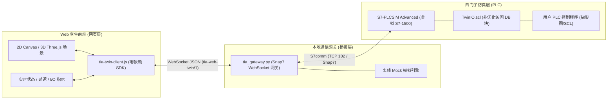

# PLCSIM Web Twin (S7comm)

> **西门子博途 (TIA Portal / PLCSIM Advanced) 与 Web 产线数字孪生协同仿真开发规范与工具链**  
> *A standardized AI Skill & Toolkit bridging Web 2D/3D Digital Twins and Siemens S7-PLCSIM Advanced via S7comm.*

[](LICENSE)
[](https://python.org)
[](https://support.industry.siemens.com)
[](references/contract.md)

---

## 📖 这个 Skill 解决什么

让 AI 生成的网页不再是“孤立的动画”，而是一个**遵循固定 I/O 契约的工业被控对象模型**：

```text
浏览器数字孪生 (2D/3D)  ⇄  WebSocket JSON  ⇄  tia_gateway.py (snap7/S7comm)  ⇄  PLCSIM Advanced (虚拟 S7-1500)
```

* **浏览器不直连 S7comm**：通过本地轻量 Python 网关桥接，网页只负责机构运动、碰撞检测与操作台。
* **控制逻辑保留在 PLC**：网页只响应 PLC 输出、计算传感器并回写；所有联锁与控制均由 PLC 梯形图/SCL 执行。
* **两模式体验**：页面默认处于**离线仿真**（无需博途即可调试动画与传感器）；点击“连接 PLC”输入 IP 即可热切换至**实时联调**。
* **零终端 / 无代码操作**：最终用户只需双击启动脚本或单文件 exe，无需输入命令行。

---

## ⚡ 快速开始

### 1. 开发者 / AI 一键生成项目

```bash
# 生成 2D Canvas 产线操作台
python scripts/make_project.py --out ./my-sorting-line

# 生成 3D Three.js 产线数字孪生 (内置本地 vendor，离线可用)
python scripts/make_project.py --out ./my-sorting-line-3d --scene 3d
```

### 2. 最终用户：双击即运行（无需敲命令）

把生成的项目文件夹交给最终用户：
* **Windows**：双击 `start_twin.bat`
* **Linux**：双击 `start_twin.desktop` 或运行 `./start_twin.sh`

> 首次启动会自动创建 `.venv` 并安装依赖，随后自动调起浏览器展示界面。

### 3. 完全无 Python / 终端分发（Windows 单文件 exe）
在 Windows 构建机上双击 `build_exe.bat`，即可在 `dist/` 下生成 `TIAWebTwin.exe`。发给用户直接双击运行，内置微型控制窗口与完整网关。

---

## 🌟 核心规范与“4合1”交付体系



1. **`twin.manifest.json`（统一信号契约）**：声明每个变量的 ID、PLC 绝对地址（如 `DB1.DBX0.0`、`DB1.DBD4`）、数据类型（Bool, Real, Int16）、读写权限（r/w/rw）与写模式（pulse 点动 / level 电平）。
2. **`TwinIO.scl`（博途非优化 DB 源码）**：由 `generate_scl.py` 根据 manifest 自动生成，强制声明 `{ S7_Optimized_Access := 'FALSE' }` 并自动计算填充字节，在博途中一键生成 DB1。
3. **`tia-twin-client.js`（零依赖前端客户端）**：网页直接引入，内置断线重连、心跳保活、延迟显示（RTT）、信号监听（`client.on('tag:id', cb)`）与点动控制（`client.pulse('cmd.start')`）。
4. **`tia_gateway.py`（通用桥接网关）**：基于 `python-snap7` 和 `websockets`，采用差量扫描引擎（仅在变量变动时广播 JSON），内置 `--mock` 离线模拟测试功能。

---

## 📂 目录结构

```text
plcsim-web-twin/
├── SKILL.md                          # AI Agent Skill 核心规范与约束
├── scripts/
│   ├── make_project.py              # 一键脚手架：生成 2D/3D 孪生工程
│   ├── tia_gateway.py               # WebSocket <-> S7comm (Snap7) / Mock 高性能网关
│   ├── generate_scl.py              # 从 manifest 一键生成博途 SCL 外部源文件
│   ├── validate_manifest.py         # 信号清单校验脚本 (地址对齐、重叠检测)
│   ├── run_twin.py                  # 自动化 / 调试运行启动器
│   ├── start_twin.bat / .sh         # 用户双击启动脚本 (Win/Linux)
│   ├── build_exe.bat                # Windows PyInstaller 单文件打包脚本
│   ├── desktop_app.py               # 无终端桌面端控制入口
│   ├── tia_twin.spec                # PyInstaller 打包规格文件
│   └── requirements.txt             # 运行依赖
├── assets/
│   ├── runtime/
│   │   └── tia-twin-client.js       # 前端零依赖标准客户端库
│   ├── template/                    # 2D Canvas 产线模板工程
│   │   ├── index.html / app.js
│   │   ├── styles.css
│   │   ├── twin.manifest.json
│   │   └── gateway.config.json
│   ├── three-demo/                  # 3D Three.js 产线模板工程 (含本地 vendor)
│   │   ├── index.html
│   │   └── vendor/
│   └── tia/
│       └── TwinIO.scl               # 自动生成的博途非优化 DB1 外部源文件
└── references/
    ├── contract.md                  # tia-web-twin/1 WebSocket 通信协议规范
    ├── deployment.md                # 部署与无终端方案说明
    └── tia-setup-guide.md           # 博途与 PLCSIM Advanced 关键配置手册
```

---

## ⚙️ 与西门子博途 / S7-PLCSIM Advanced 联调

要与真实的博途高级仿真器通信，请遵循以下 4 步关键设置（详见 [references/tia-setup-guide.md](references/tia-setup-guide.md)）：

1. **PLCSIM Advanced 设置**：
   * Online Access 必须选择 **`Siemens PLCSIM Virtual Ethernet Adapter`**（虚拟以太网卡，严禁选 Softbus）。
   * 启动虚拟 CPU，分配独立 IP（如 `192.168.0.50`）。
2. **博途项目支持仿真**：
   * 博途项目树根节点右键 -> **属性** -> **保护** -> 勾选 **“块编译时支持仿真”**。
3. **CPU 连接机制**：
   * CPU 属性 -> **防护与安全** -> **连接机制** -> 勾选 **“允许来自远程对象的 PUT/GET 通信访问”**。
4. **导入数据块**：
   * 将 `TwinIO.scl` 复制到博途“外部源文件”中，右键点击 **“从源文件生成块”**。
   * 编译程序并下载到 PLCSIM Advanced 中，将 CPU 切换为 RUN。

---

## 🤖 作为 AI Agent Skill 使用

本工程遵循 Antigravity / Cursor / Claude Code / Qoder 的 Skill 规范，只需将此目录挂载至：
* 全局配置：`~/.gemini/config/skills/plcsim-web-twin` 或 `~/.qoder-cn/skills/plcsim-web-twin`
* 或工作区：`.agents/skills/plcsim-web-twin`

AI 助手将自动理解 `tia-web-twin/manifest@1` 契约，并按照工业级规范为你成套生成数字孪生网页与博途 SCL 代码。

---

## 📄 开源许可证

本项目基于 [MIT License](LICENSE) 开源。
