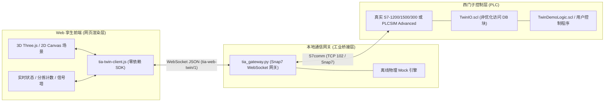

# Siemens S7 Web Twin (S7comm: 真实硬件 PLC + PLCSIM)

> **西门子PLC (S7-1200 / S7-1500 / S7-300) 与 PLCSIM Advanced 数字孪生产线协同开发规范与工具链**  
> *A standardized AI Skill & Toolkit bridging Web 2D/3D Digital Twins and Siemens S7 Hardware PLCs / PLCSIM Advanced via S7comm.*

[](LICENSE)
[](https://python.org)
[](https://support.industry.siemens.com)
[](references/contract.md)
[](references/deployment.md)

---

## 📖 这个 Skill 解决什么

让 AI 生成的产线网页不再是“孤立的动画”，而是一个**遵循固定工业 I/O 契约的工业被控对象数字孪生模型**：

```text
浏览器 3D/2D 数字孪生  ⇄  WebSocket JSON  ⇄  tia_gateway.py (Snap7/S7comm)  ⇄  真实 S7 PLC (S7-1200/1500/300) / PLCSIM Advanced
```

* **双目标原生支持**：底层基于工业级 S7comm 协议（ISO-on-TCP，默认端口 102），一套代码**无缝支持真实西门子硬件 PLC 与虚拟 PLCSIM Advanced**。
* **动静分离，纯信号驱动**：控制逻辑严格保留在 PLC 内部；网页只负责机构运动、光电传感器计算与实时展示。PLC 输出 1 则运动，0 则停止，严禁前端伪造虚假常转动画。
* **双用途原生支持：工业现场纯监控 vs 虚拟教学实训**：
  - **模式 A：工业现场纯监控看板 (SCADA/HMI)**：连接工厂真实运行产线，纯只读监控 Q/I/M/DB 状态、速度与产量，**严禁回写虚拟传感器**，零侵入原有控制系统。
  - **模式 B：虚拟产线闭环教学实训 (Digital Twin Training)**：面向无实体机构的裸机 PLC 或 PLCSIM，网页作为被控对象，物料到位后自动向非优化 DB (`TwinIO`) 回写虚拟传感器信号；配套自动生成 `TwinDemoLogic.scl` 示例程序，OB1 一键调用秒级联调。
* **有限资料下的机械合理化与 120Hz 刚体物理规范**：
  - **零悬浮生根**：无 CAD 资料时，AI 自主配置 4040/4020 型材立柱、三角加强角码、底盘法兰与 T 槽底座，消除气缸/料仓/滑道空中悬浮；
  - **全线标高基准链统一**：推导工件承托面基准标高 $Y_0$（如统一为 $0.782\text{m}$），消除工站流转阶梯错位；
  - **运动包络与动力学校验**：转台外围构件避让回转包络线，滑槽按牛顿第二定律倾角自滑（$22^\circ$），末端配置缓冲止挡；
  - **120Hz 离线真物理**：告别插值假动画，采用 120Hz 离线刚体微步长求解、材质接触摩擦矩阵与 3D Raycast 光电传感器。
* **通信扫描周期自由可调 (50ms / 100ms)**：
  - **`50 ms (20 Hz · 高速响应)`**：机构物理孪生首选，气缸推拉、高速光电对射检测与碰撞几乎**零延迟**，动作丝滑顺畅。
  - **`100 ms (10 Hz · 工业标准)`**：经典工业 SCADA / HMI 推荐节拍，网络通信包少，CPU 占用极低，对通信处理机（CP）最温和。
  - **即切即生效**：网页顶部栏与连接弹窗均提供扫描周期下拉选择，左下角 HUD 实时显示通信周期，运行中动态切换无需重连。
* **双模式开箱即用**：页面默认处于**离线仿真**（内置 Three.js 物理碰撞与 Mock 引擎，无需 PLC 即可单机演示）；点击“连接 PLC”即可热切换至**真实 S7 通信**。
* **零环境依赖 / 绿色便携开箱即用**：脚手架自动内置 ~20MB 极简 Python 运行环境（预装 `snap7` 与 `websockets`），**现场目标工控机完全无需安装 Python、无需联网、无需配置环境变量、无需管理员权限**，拷贝即跑。
* **零终端 / 无门槛交互**：完美规避 Windows 11 24H2 安全拦截与跨盘符虚拟环境陷阱，提供桌面图标一键直达，用户无需敲任何命令行。

---

## ⚡ 快速开始（AI 自动化生成）

### 1. 开发者 / AI 一键生成项目

AI Agent 在后台静默执行项目脚手架（严禁让用户在终端敲命令）：

```bash
# 生成 3D Three.js 工业产线数字孪生 (内置本地 vendor 与 20MB 绿色 Python 运行时，最推荐)
python scripts/make_project.py --out ./my-sorting-line-3d --scene 3d

# 生成 2D Canvas 经典产线操作台
python scripts/make_project.py --out ./my-sorting-line-2d
```

### 2. 最终用户：3 种免终端启动方式（无需安装 Python）

交付给用户的工程默认自带 20MB 绿色便携 Python 与纯 7-bit ASCII 启动器（100% 兼容 Windows 11 24H2）：

| 方式 | 适合场景 | 操作方法 |
| :--- | :--- | :--- |
| **方式 1：桌面图标一键直达** | **日常最推荐**，连目录都不用进 | 双击运行一次 `make_shortcut.bat` 在桌面生成快捷方式，以后在桌面直接双击图标秒开 |
| **方式 2：目录双击启动** | 在项目文件夹内直接使用 | 双击运行 `start.bat`，优先直调自带绿色环境、启动双服务并自动唤起默认浏览器 |
| **方式 3：后台静默常驻** | 讨厌黑窗口，或车间平板跨设备访问 | 双击 `start_silent.bat`，黑窗口 3 秒后自动消失，后台静默常驻；用浏览器输入网址/书签直接打开。关闭时运行 `stop.bat` |

---

## 🌟 核心规范与“5合1”工业交付体系



1. **`twin.manifest.json`（统一信号契约）**：声明每个变量的 ID、PLC 绝对地址（如 `DB1.DBX0.0`、`DB1.DBB1`）、数据类型（Bool, Byte, Real, Int16）、读写权限（r/w/rw）与写模式（pulse 点动 / level 电平）。
2. **`TwinIO.scl`（博途非优化 DB 源码）**：由 `generate_scl.py` 根据 manifest 自动生成，强制声明 `{ S7_Optimized_Access := 'FALSE' }`，在博途中一键生成 DB1。
3. **`TwinDemoLogic.scl`（博途配套示例控制程序）**：与 DB 同步生成，内置启停自锁、光电感应推料延时、复位与计数逻辑。在博途 OB1 中插入一行 `"TwinDemoLogic"();` 即可立即让 3D 产线跑起来，彻底解决首次连上真实 PLC 时“因 PLC 内部无逻辑导致画面静止”的冷启动断层。
4. **`tia-twin-client.js`（零依赖前端客户端）**：网页直接引入，内置断线重连、心跳保活、延迟显示（RTT）、信号监听（`client.on('tag:id', cb)`）与点动控制（`client.pulse('cmd.start')`）。
5. **`tia_gateway.py`（通用桥接网关）**：基于 `python-snap7` 和 `websockets`，采用差量扫描引擎（仅在变量变动时广播 JSON），支持通过 `plc.configure` 运行时热切换目标 PLC。

---

## 📂 目录结构

```text
siemens-s7-web-twin/
├── SKILL.md                          # AI Agent Skill 核心规范、13 大红线与标准 SOP
├── README.md                         # 项目总体说明与快速指南
├── scripts/
│   ├── make_project.py              # 一键脚手架：自动装配 2D/3D 孪生工程与内置便携运行时
│   ├── tia_gateway.py               # WebSocket <-> S7comm (Snap7) / Mock 高性能网关 (支持 50ms/100ms 动态扫描)
│   ├── generate_scl.py              # 从 manifest 一键生成博途 DB 与控制逻辑 SCL 外部源文件
│   ├── validate_manifest.py         # 信号清单校验脚本 (地址对齐、重叠与读写字节隔离检测)
│   ├── run_twin.py                  # 服务管理与浏览器自动唤起启动器
│   ├── start.bat                    # Windows 极简启动器 (优先调用 ./runtime/ 绿色运行环境)
│   ├── make_shortcut.bat            # 原生 PowerShell 桌面快捷方式生成器
│   ├── start_silent.bat             # 后台静默启动器 (无黑窗口)
│   ├── stop.bat                     # 后台服务一键终止脚本
│   ├── start_twin.bat / .sh         # 兼容启动脚本 (Win/Linux)
│   ├── start_twin.desktop           # Linux 桌面图标双击启动
│   ├── build_exe.bat                # Windows PyInstaller 打包脚本
│   ├── desktop_app.py               # 独立桌面端控制入口
│   ├── tia_twin.spec                # PyInstaller 打包规格文件
│   └── requirements.txt             # 运行依赖
├── assets/
│   ├── runtime/
│   │   ├── portable-runtime.zip     # 内置官方免安装极简 Python 3.11 运行时 (含 snap7/websockets)
│   │   └── tia-twin-client.js       # 前端零依赖标准客户端库 (支持动态 poll.rate 扫描周期调度)
│   ├── template/                    # 2D Canvas 经典产线模板工程
│   │   ├── index.html / app.js / styles.css
│   │   ├── twin.manifest.json
│   │   └── gateway.config.json
│   ├── three-demo/                  # 3D Three.js 现代化工业产线模板工程
│   │   ├── index.html / app.js / styles.css (含 50ms/100ms 扫描周期切换器)
│   │   └── vendor/                  # 本地离线 Three.js 核心库 (OrbitControls 等)
│   └── tia/
│       ├── TwinIO.scl               # 自动生成的博途非优化 DB1 外部源文件
│       └── TwinDemoLogic.scl        # 自动生成的博途配套示例控制逻辑 (OB1 直接调用)
└── references/
    ├── contract.md                  # tia-web-twin/1 WebSocket 通信协议规范 (含 poll.rate)
    ├── deployment.md                # 部署与无环境/无终端方案说明 (含 Win11 24H2 避坑与绿色便携包)
    └── tia-setup-guide.md           # 实体真实 PLC 与 PLCSIM Advanced 关键配置手册
```

---

## ⚙️ 接入真实 PLC / PLCSIM 硬件配置指南

无论连接实体 PLC 还是仿真器，只需完成以下 3 步设置（详见 [references/tia-setup-guide.md](references/tia-setup-guide.md)）：

### 1. 硬件/仿真器网络互通
* **真实 PLC**：网线直连，将电脑网卡 IP 改为与 PLC 同一网段（例如 PLC 为 `192.168.0.10`，电脑设为 `192.168.0.100`），CMD 中 `ping` 测试通过。
* **PLCSIM Advanced**：Online Access 必须选择 **`Siemens PLCSIM Virtual Ethernet Adapter`**（严禁选 Softbus），启动实例并分配 IP（如 `192.168.0.1`）。

### 2. 博途 (TIA Portal) 关键属性与程序导入
* **放行 PUT/GET 通信**：打开 CPU 设备组态 -> **属性** -> **防护与安全** -> **连接机制** -> 勾选 **“允许来自远程对象的 PUT/GET 通信访问”**（真实 PLC 必勾！）。
* **导入数据块**：将工程生成的 `TwinIO.scl` 加入博途“外部源文件”，右键点击 **“从源生成块”**。确认生成的 DB 为非优化数据块（核对编号是否为 DB1）。
* **导入示例控制程序（可选，1 分钟闭环测试）**：将 `TwinDemoLogic.scl` 同样加入外部源文件并生成 FC 块，在主循环组织块 **OB1 ("Main")** 中插入一行 `"TwinDemoLogic"();`。
* **编译并下载**：全部编译并下载到 CPU，将 CPU 拨到 **RUN** 绿灯模式。

### 3. 网页连接与扫描周期设置
打开 3D 数字孪生页面：
1. 点击右上角 **“连接 PLC”**；
2. 选择目标机型（S7-1200/1500 默认 Rack 0 Slot 1，S7-300 默认 Rack 0 Slot 2）；
3. 选择 **通信扫描周期**（高速物理孪生推荐 `50ms`，标准推荐 `100ms`）；
4. 输入 PLC IP 点击连接即可实时双向闭环通讯。

---

## 🛡️ 工业通讯与 Windows 11 24H2 避坑要点

1. **废弃 VBScript**：全面淘汰 `.vbs` 脚本，改用纯 7-bit ASCII `.bat` 与原生 PowerShell 实现无黑窗静默运行；
2. **避免单文件 exe 临时目录拦截**：Win11 24H2 严格拦截第三方单文件向 `%TEMP%` 动态解压二进制（报 `Could not create temporary directory!`），日常使用推荐原生批处理与桌面快捷方式，或 `--onedir` 文件夹打包；
3. **避免跨盘符虚拟环境 DLL 加载失败**：非系统盘创建 `.venv` 易触发 `_ctypes` DLL 初始化失效。启动脚本原生**优先加载自带 20MB 绿色便携环境（./runtime/）**，无便携包时无缝回退至物理机 Python，杜绝跨盘符 DLL 冲突；
4. **严禁向物理输入区（%I）直写**：PLC 扫描周期起始阶段以微秒级硬件中断执行“过程映像输入 (PII)”刷新，强写 `%I` 会在微秒内被悬前端子置 0。虚拟传感器必须写入非优化数据块（`TwinIO` DB）供 PLC 逻辑读取；
5. **读写字节严格隔离（Byte Isolation）**：S7comm 底层位写入为字节级“读-改-写 (Read-Modify-Write)”。严禁在同一字节内混排只读位（`r`）与写入位（`w`），防止上位机回写覆盖 PLC 刚更新的输出；
6. **规避浏览器 ES 模块本地强缓存**：现代浏览器对本地 ES 模块具有激进缓存。项目 `run_twin.py` 服务端强制注入 `Cache-Control: no-cache, no-store, must-revalidate`，前端引用附加 `?v=...` 穿透参数，杜绝代码修改后浏览器读取旧缓存失效；
7. **回转机构传感器消除旋转角偏置**：分度转台旋转时，工件角度发生动态位移。传感器判定必须消除转台旋转偏置（`((p.theta - m.table.angle) % 360 + 360) % 360`），杜绝顺控程序在分度工位陷入无限超时等待。


---

## 🤖 作为 AI Agent Skill 使用

本工程遵循 Antigravity / Cursor / Claude Code / Qoder 的 Skill 规范，只需将此目录挂载至：
* 全局配置：`~/.gemini/config/skills/siemens-s7-web-twin` 或 `~/.agents/skills/siemens-s7-web-twin`
* 或工作区：`.agents/skills/siemens-s7-web-twin`

AI 助手将自动理解机电拓扑契约，并在后台全自动完成 manifest 编写、SCL 生成与零命令脚手架搭建。

---

## 📄 开源许可证

本项目基于 [MIT License](LICENSE) 开源。
