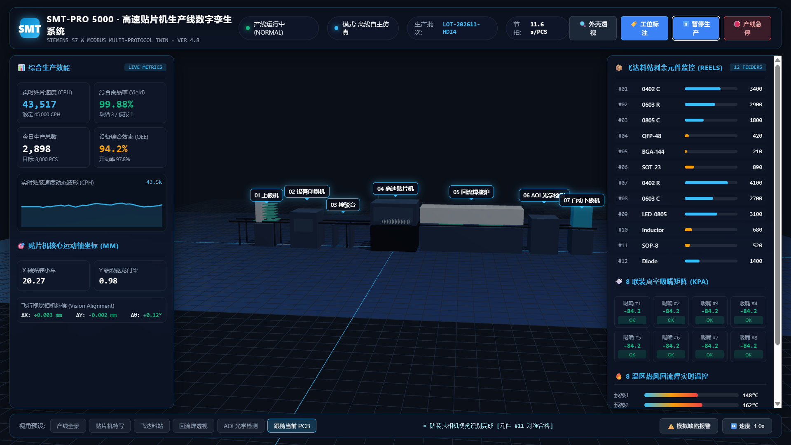
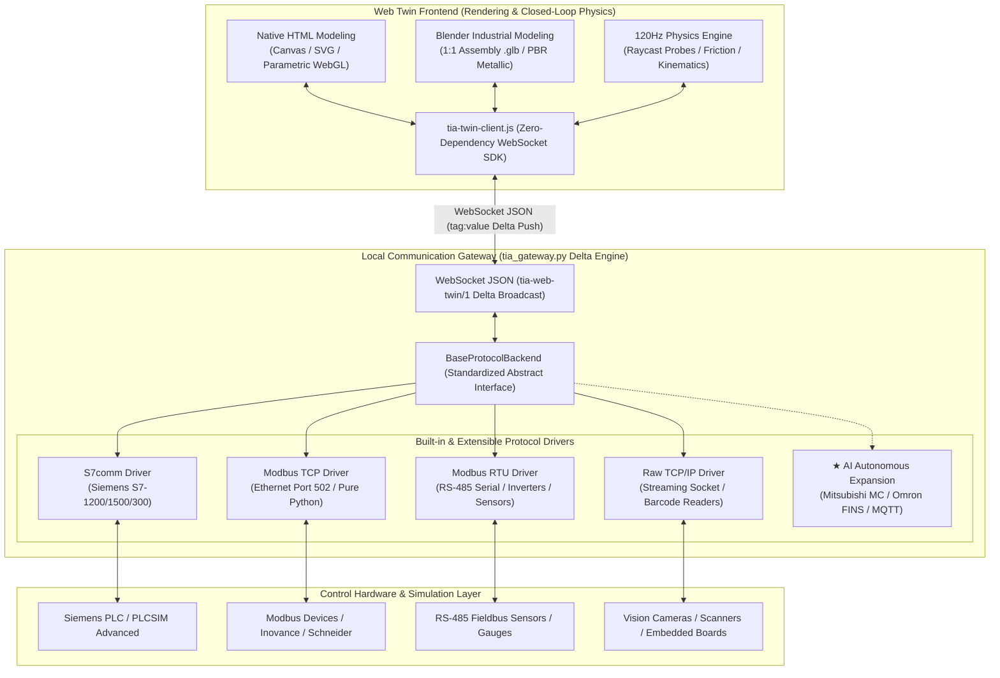

<div align="center">

# 🏭 Industrial Web Digital Twin & Multi-Protocol Control Platform
### Standardized Web 3D/2D Industrial Digital Twin & Multi-Protocol Gateway

<p align="center">
  <a href="README.md"><b>[ 简体中文 ]</b></a> &nbsp;|&nbsp; <b>[ English ]</b>
</p>

> **Dual Modeling Paradigms**: [Native HTML Modeling (Instant code-based rendering)] & [Blender Industrial High-Fidelity Modeling (Fully replaces NX/SolidWorks)]  
> **Multi-Protocol Connectivity**: Native support for Siemens S7 (S7comm), Modbus TCP, Modbus RTU (RS-485), Raw TCP/IP, and autonomous AI protocol expansion.  
> *A standardized Industrial Digital Twin & Multi-Protocol Gateway bridging Web 3D/2D Interfaces and Physical PLCs / Simulators.*

[](LICENSE)
[](https://python.org)
[](https://support.industry.siemens.com)
[](references/protocol-extension-guide.md)
[](references/blender-industrial-modeling.md)
[](references/deployment.md)
[](references/deployment.md)

<p align="center">
  <a href="#-core-breakthroughs">Core Breakthroughs</a> •
  <a href="#-featured-showcase-smt-pick--place-line">Showcase</a> •
  <a href="#-system-architecture">System Architecture</a> •
  <a href="#-dual-modeling-paradigms-native-html-vs-blender-cad">Modeling Paradigms</a> •
  <a href="#-multi-protocol-connectivity--ai-extension">Protocols</a> •
  <a href="#-quick-start">Quick Start</a> •
  <a href="#-industrial-io-contract-suite">Delivery Standard</a> •
  <a href="#-pitfall-prevention">Pitfalls</a>
</p>

<div align="center">
  <br/>
  
  <p><em>▲ Featured Showcase: SMT High-Speed Pick & Place Production Line Web 3D Digital Twin & SCADA (See <a href="examples/贴片机">examples/贴片机</a>)</em></p>
</div>

</div>

---

## 🌟 Core Breakthroughs

Transforming Web 3D industrial visualization from "isolated, fake showcase animations" into **closed-loop physical twins that strictly follow industrial I/O signal contracts with real-time feedback**:

| Dimension | Traditional Web 3D / Toy Demos | Our Industrial Digital Twin Standard |
| :--- | :--- | :--- |
| **Visual Fidelity** | AI-generated blocky meshes or heavy CAD exports | **Dual Paradigm**: Pure code native HTML vs. Blender PBR (Fully replaces NX/SolidWorks) |
| **Industrial Comms** | Locked to proprietary SCADA or bloated OPC UA | **Native Multi-Protocol** (S7comm, Modbus TCP, Modbus RTU, TCP-IP) with pluggable AI expansion |
| **Kinematics & Control** | Hardcoded looping animations with zero feedback | **Static vs. Dynamic hierarchy, signal-driven**: PLC output 1 moves, 0 stops; sensors write back to PLC |
| **Deployment Barrier** | Requires complex Node.js/Python build chains | **Built-in ~20MB portable Python runtime**, 100% Windows 11 24H2 compliant, 1-click desktop launch |

---

## 🏭 Featured Showcase: SMT Pick & Place Line

Explore [`examples/贴片机`](examples/贴片机): A complete production-grade Surface Mount Technology (SMT) production line digital twin:
* **7 Full Machine Stations**: Magazine Loader, Solder Paste Stencil Printer, Buffer Conveyor, High-Speed Pick & Place Machine (12 Feeder reels, 8 vacuum nozzles, flying vision alignment camera), 8-Zone Reflow Oven, AOI Optical Inspection, and Unloader.
* **Dual Operation Mode**: Instant double-click offline autonomous kinematics simulation OR live PLC WebSocket gateway integration.
* **Zero-Clipping Physics Guarantee**: Conveyor elevation rigidly unified at `Y = 2.40m`, 3-phase safe stroke kinematics preventing nozzle-PCB penetration.
* **Siemens S7-1500 / S7-1200 DB1 Ready**: Validated I/O manifest with auto-generated `TwinIO.scl` external source file.

---

## 🏗️ System Architecture



---

## 🎨 Dual Modeling Paradigms: Native HTML vs. Blender CAD

Eliminate the ambiguous "2D vs 3D" debate by making a clear engineering asset pipeline decision:

```text
User Requirement ──► Clear Decision:
                      ├──► Option A: 【Native HTML Modeling】 (Pure code, 0 external assets, fastest prototyping)
                      └──► Option B: 【Blender Industrial CAD】 (Replaces heavy CAD, PBR .glb assets, shopfloor delivery)
```

### 1. Native HTML Modeling (`--mode html`)
* **Best For**: Rapid prototype validation, lightweight training, zero-asset instant launch.
* **Tech**: Canvas / SVG / Parametric Three.js procedural geometry directly generated in frontend.
* **Pros**: Zero external file dependencies, ultra-compact size (< 2MB), loads in milliseconds.

### 2. Blender Industrial Modeling (`--mode blender` · Replaces NX / SolidWorks)
* **Best For**: 100% photorealistic industrial equipment, digital showroom, physical production line twins.
* **Why replace heavy CAD**: Traditional CAD exports millions of polygons with lost hierarchies and broken normals. Blender supports parametric sketches via `CAD Sketcher`, exports optimized glTF 2.0 (`.glb`), limits polygon count to 100k~300k, and provides native PBR materials and emissive effects.
* **Modeling SOP**: See [Blender Industrial Modeling Guide](references/blender-industrial-modeling.md).
* **Asset Inspector Tool**:
  ```bash
  python scripts/inspect_glb.py assets/models/my_line.glb
  ```

---

## 🌐 Multi-Protocol Connectivity & AI Protocol Extension

The Web twin frontend is **completely decoupled** from underlying industrial fieldbus protocols via WebSocket JSON.

### 1. Built-in Protocol Matrix
* **Siemens S7comm (`protocol: "s7"`)**: ISO-on-TCP (Port 102), supports S7-1200 / 1500 / 300 / 400 and PLCSIM Advanced:
  - Penetrates non-optimized DB blocks (`DB1`, `DB2`...), Physical Inputs (%I), Physical Outputs (%Q), and Flags (%M).
  - Handles 16-bit analog channels (`IW64`, `QW64`, `0~27648`) and IEEE 754 32-bit floats (`DBD4`, `MD20`).
  - Auto-groups consecutive memory ranges to minimize round-trip latency at 10~30Hz refresh rates.
* **Modbus TCP (`protocol: "modbus-tcp"`)**: Pure async Python implementation without external dependencies, supporting coils `0x/1x` and registers `3x/4x`.
* **Modbus RTU / RS-485 (`protocol: "modbus-rtu"`)**: Serial fieldbus for inverters, power meters, and temperature controllers.
* **Raw TCP/IP Socket (`protocol: "tcp-raw"`)**: Raw byte streams with delimiter framing for barcode scanners and custom embedded boards.

### 2. AI Autonomous Protocol Extension (10-Minute Delivery)
When encountering **Mitsubishi MC, Omron FINS, MQTT, or Beckhoff ADS**, instruct the AI Agent to follow [`references/protocol-extension-guide.md`](references/protocol-extension-guide.md):
1. Subclass `BaseProtocolBackend`, implement `ensure_connected`, `read_all`, `write`, and `status`.
2. Register the protocol in the gateway factory.
3. The frontend digital twin communicates with the new hardware immediately!

---

## ⚡ Quick Start

### 1. Developer / AI Agent Scaffolding
Run scaffolding from the repository root:
```bash
# Mode A: Blender industrial high-fidelity 3D asset modeling (Recommended)
python scripts/make_project.py --out ./my-sorting-line --mode blender

# Mode B: Native HTML pure code modeling (Instant prototype)
python scripts/make_project.py --out ./my-sorting-line --mode html
```

### 2. End-User Launch Options (No Python Installation Required)
Generated projects include a **built-in ~20MB portable Python runtime** and 7-bit ASCII launchers (100% Windows 11 24H2 certified):

| Launch Mode | Use Case | Action |
| :--- | :--- | :--- |
| **Option 1: Desktop Shortcut** | **Recommended** for operators | Double-click `make_shortcut.bat` once to create desktop icon |
| **Option 2: Direct Batch Launch** | Local engineering debug | Double-click `start.bat` to launch gateway and browser |
| **Option 3: Silent Background Service** | Workshop tablets / Remote access | Double-click `start_silent.bat` (hidden background window); stop via `stop.bat` |

---

## 📦 Industrial I/O Contract Suite ("5-in-1")

1. **`twin.manifest.json` (Unified Signal Contract)**: Single source of truth defining tag IDs, PLC memory addresses, data types, and access modes.
2. **`TwinIO.scl` (TIA Portal Non-Optimized DB)**: Generated from manifest with `{ S7_Optimized_Access := 'FALSE' }` for 1-click import into TIA Portal.
3. **`TwinDemoLogic.scl` (Closed-Loop Control Logic)**: Auto-generated logic for start/stop interlock, photoelectric sensor triggers, and reset.
4. **`tia-twin-client.js` (Zero-Dependency Frontend SDK)**: Built-in heartbeat, RTT latency monitoring, and offline mock fallback.
5. **`tia_gateway.py` (Multi-Protocol Delta Gateway)**: High-throughput delta broadcasting engine with runtime device switching.

---

## 📁 Repository Structure

```text
siemens-s7-web-twin/
├── SKILL.md                          # AI Agent Skill specification & 18 industrial hard rules
├── README.md                         # Chinese documentation
├── README_en.md                      # English documentation (This file)
├── examples/
│   └── 贴片机/                       # SMT Pick & Place Line Digital Twin Showcase (3D/SCADA/Blender/SCL/Gateway)
├── scripts/
│   ├── make_project.py              # 1-click project scaffolder
│   ├── inspect_glb.py               # 3D asset node inspector & binding generator
│   ├── tia_gateway.py               # Multi-protocol gateway (S7 / Modbus / Raw TCP)
│   ├── generate_scl.py              # TIA Portal DB & SCL source code generator
│   ├── validate_manifest.py         # Signal manifest syntax & memory alignment checker
│   ├── run_twin.py                  # Service supervisor & browser launcher
│   ├── start.bat                    # Windows launcher (calls ./runtime/ portable Python)
│   ├── make_shortcut.bat            # Desktop shortcut generator
│   ├── start_silent.bat             # Background silent launcher
│   ├── stop.bat                     # 1-click service shutdown
│   ├── start_twin.bat / .sh         # Cross-platform startup scripts (Win / Linux)
│   ├── build_exe.bat                # PyInstaller packaging script
│   └── requirements.txt             # Python dependencies
├── assets/
│   ├── runtime/
│   │   ├── portable-runtime.zip     # Portable Python 3.11 runtime (includes snap7 & websockets)
│   │   └── tia-twin-client.js       # Zero-dependency frontend client SDK
│   ├── template/                    # Native HTML template
│   ├── three-demo/                  # Blender WebGL template
│   └── tia/
│       ├── TwinIO.scl               # Sample TIA Portal DB1 external source
│       └── TwinDemoLogic.scl        # Sample control logic
└── references/
    ├── protocol-extension-guide.md  # Multi-protocol extension specification
    ├── blender-industrial-modeling.md # Blender industrial modeling SOP (Replaces CAD)
    ├── cad-import-guide.md          # 3D CAD asset import & binding guide
    ├── contract.md                  # tia-web-twin/1 WebSocket protocol spec
    ├── deployment.md                # Deployment & Windows 11 24H2 notes
    └── tia-setup-guide.md           # Physical PLC & PLCSIM Advanced configuration guide
```

---

## 🛡️ Industrial Comms & Windows 11 24H2 Pitfall Prevention

1. **Deprecated VBScript**: Replaced all `.vbs` with pure 7-bit ASCII `.bat` and native PowerShell to prevent Windows 11 24H2 deprecation blocks.
2. **Avoid Single-File Temp Executable Blocking**: Win11 24H2 strictly restricts single-file exe decompression into `%TEMP%`. Native portable folders and shortcuts are recommended.
3. **Prevent Drive Letter Virtualenv Conflicts**: Launchers prioritize the local `./runtime/` environment, eliminating environment variable tampering.
4. **Never Direct-Write to Physical Inputs (%I)**: PLC scan cycles refresh Process Image Inputs (PII) at microsecond intervals; writing to `%I` will be immediately overwritten by floating terminals. Virtual sensors must write to non-optimized DB blocks (`TwinIO` DB) or Modbus registers.
5. **Strict Byte Isolation**: Bit writes are atomic read-modify-write byte transactions. Never mix read-only bits (`r`) and writable bits (`w`) within the same byte.
6. **Bypass Browser Local Cache**: `run_twin.py` injects `Cache-Control: no-cache, no-store` headers to ensure frontend code updates take effect immediately.

---

## 📄 License

This project is licensed under the [MIT License](LICENSE).
Contributions from industrial automation, digital twin, and IoT engineers worldwide are warmly welcome!
