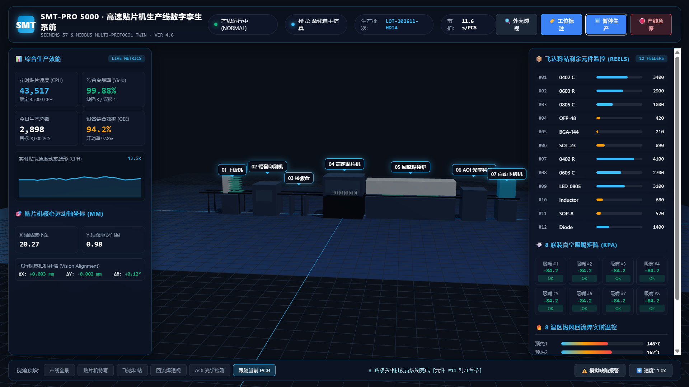

# 🏭 SMT 高速贴片机生产线 · Web 数字孪生与工业上位机示例项目

  <b>[ 简体中文 ]</b> &nbsp;|&nbsp; <a href="README_en.md"><b>[ English ]</b></a>

> 本示例位于 `siemens-s7-web-twin/examples/贴片机`，是遵循本项目标准架构（I/O 信号契约、动静分离、零穿模、多协议网关）打造的**工业级贴片机产线完整数字孪生应用**。

  
  
<em>▲ SMT 高速贴片机生产线数字孪生与工业上位机实测运行界面</em>

---

## 🌟 核心特性与亮点优化

1. **工业级双模式平滑切换**：
   - **离线自主仿真模式 (Offline Mode)**：直接双击打开 `index.html`，无需安装任何网关服务，内置三段式机械运动学闭环仿真与 SCADA 仪表盘。
   - **网关直连模式 (Live PLC Link)**：双击运行 `start.bat`，本地多协议网关 (`tia_gateway.py`) 启动，通过 `tia-twin-client.js` 与前端建立 WebSocket 长连接，真实对接西门子 S7-1500/1200 PLC、Modbus 或 Mock 驱动。
2. **严丝合缝的零穿模 (Zero-Clipping) 工业机构学**：
   - 传送轨顶基准面严格锁定在 `Y = 2.40m`，各工位导轨宽度 1.6m 绝对同轴对齐。
   - 贴装头横移时吸嘴保持在安全抬刀高度 `Z_SAFE`；取料行程严格对齐飞达料槽表面；贴装行程下潜深度严格停止在焊盘表面 `Y_PAD = TRACK_Y + PCB_THICKNESS`。
3. **符合六大工业铁律的 Blender 自动化建模**：
   - 包含 `smt_blender_script.py`，严格遵循 `references/blender-industrial-modeling.md`：
     - 静态铝型材机架与地脚合并网格（降低 Draw Call，保障 120 FPS）。
     - 独立运动装配树：`SMT_Gantry_Y` -> `SMT_Head_X` -> `SMT_Nozzle_Array`。
     - 贴装吸嘴 Origin 精准设在套筒顶端，方便直接对齐 PLC Z 轴行程。
4. **博途外部源文件 (SCL) 一键导入**：
   - 提供自动生成的 `TwinIO.scl` 与 `TwinDemoLogic.scl`，西门子工程师可在博途 (TIA Portal) 中一键导入生成 DB1 数据块。

---

## 📁 目录文件清单

| 文件 | 描述 |
| :--- | :--- |
| [`index.html`](index.html) | 数字孪生前端主页面（SCADA 仪表盘 + 3D 视口） |
| [`app.js`](app.js) | Three.js 3D 渲染管线、运动学状态机与 `tia-twin-client` 数据联动 |
| [`styles.css`](styles.css) | 工业深色玻璃态 (Glassmorphism) HUD 监控面板样式 |
| [`twin.manifest.json`](twin.manifest.json) | 工业 I/O 信号契约清单（西门子 S7 DB1 25个点位，已通过校验） |
| [`gateway.config.json`](gateway.config.json) | 本地多协议网关配置文件（支持 S7、Modbus、Mock） |
| [`TwinIO.scl`](TwinIO.scl) | 西门子博途外部源文件（自动定义 DB1 数据块结构） |
| [`smt_blender_script.py`](smt_blender_script.py) | Blender 自动化建模脚本（生成几何体、PBR 材质、动画并导出 GLB） |
| [`tia-twin-client.js`](tia-twin-client.js) | 零依赖 WebSocket 客户端通信库 |
| [`start.bat`](start.bat) | 一键启动网关与孪生系统 |
| [`stop.bat`](stop.bat) | 一键停止本地网关服务 |

---

## 🔌 西门子 S7 数据块 (DB1) 信号映射表

本示例已严格通过 `scripts/validate_manifest.py` 工业对齐校验：

| 变量 ID | PLC 物理地址 | 数据类型 | 读写 | 说明 |
| :--- | :--- | :--- | :--- | :--- |
| `cmd.start` | `DB1.DBX0.0` | Bool | RW (Pulse 200ms) | 上位机产线启动按钮 |
| `cmd.stop` | `DB1.DBX0.1` | Bool | RW (Pulse 200ms) | 上位机产线停止按钮 |
| `cmd.reset` | `DB1.DBX0.2` | Bool | RW (Pulse 200ms) | 报警复位按钮 |
| `cmd.estop` | `DB1.DBX0.3` | Bool | RW (Pulse 200ms) | 工业安全急停按钮 |
| `smt.running` | `DB1.DBX0.4` | Bool | RW | 贴片机总运行状态 (1=运行 0=停) |
| `smt.paused` | `DB1.DBX0.5` | Bool | RW | 贴片机暂停保持状态 |
| `smt.alarm_active` | `DB1.DBX0.6` | Bool | RW | 总报警指示状态 |
| `smt.xray_mode` | `DB1.DBX0.7` | Bool | RW | 外壳透视状态 |
| `sens.infeed_pe` | `DB1.DBX1.0` | Bool | RW | 进板光电检测 (1=有板 0=空) |
| `sens.clamped` | `DB1.DBX1.1` | Bool | RW | PCB 气缸夹紧到位 |
| `sens.vision_ok` | `DB1.DBX1.2` | Bool | RW | 飞行视觉相机对准合格 |
| `sens.placed_ok` | `DB1.DBX1.3` | Bool | RW | 单板贴装就绪信号 |
| `sens.reflow_in` | `DB1.DBX1.4` | Bool | RW | 回流焊入口检测 |
| `sens.aoi_result` | `DB1.DBX1.5` | Bool | RW | AOI 检测结果 (1=OK 0=NG) |
| `sens.outfeed_pe` | `DB1.DBX1.6` | Bool | RW | 出料下板光电检测 |
| `smt.feeder_index` | `DB1.DBW2` | Int16 | RW | 当前取料飞达站号 (1~12) |
| `smt.axis_x` | `DB1.DBD4` | Real (4字节对齐) | RW | X 轴小车物理坐标 (mm) |
| `smt.axis_y` | `DB1.DBD8` | Real (4字节对齐) | RW | Y 轴龙门梁物理坐标 (mm) |
| `smt.axis_z` | `DB1.DBD12` | Real (4字节对齐) | RW | Z 轴吸嘴行程深度 (mm) |
| `smt.vacuum_kpa` | `DB1.DBD16` | Real (4字节对齐) | RW | 工作吸嘴实时真空度 (kPa) |
| `smt.cph` | `DB1.DBD20` | Real (4字节对齐) | RW | 实时贴装速度 (CPH) |
| `smt.yield_rate` | `DB1.DBD24` | Real (4字节对齐) | RW | 综合良品率统计 (%) |
| `smt.total_count` | `DB1.DBD28` | Int32 (4字节对齐) | RW | 今日生产总数 (PCS) |
| `smt.reflow_temp_peak` | `DB1.DBD32` | Real (4字节对齐) | RW | 回流焊第6峰值温区实时温度 (°C) |
| `smt.alarm_code` | `DB1.DBW36` | Int16 | RW | 告警故障码 (0=无, 1=缺料, 2=偏位, 3=温控) |

---

## 🚀 运行方式

### 方式 1：双击网页秒开体验（离线自主仿真）
- 直接双击打开 [`index.html`](index.html)。
- 顶部徽标将显示 `模式: 离线自主仿真`。
- 页面内置完整的 3D 机械运动学循环、CPH 动态波形、飞达料位递减、回流焊温区显示。

### 方式 2：一键启动多协议网关（西门子 PLC / 模拟器闭环）
1. 双击运行 [`start.bat`](start.bat)。
2. 网关启动并在后台监听 `ws://127.0.0.1:8765`。
3. 浏览器自动打开，顶部徽标变为 `网关已连通 (S7/MODBUS)`，进入真实 PLC 信号驱动模式。
4. 退出时双击 [`stop.bat`](stop.bat) 即可一键释放端口并停止服务。

### 方式 3：Blender 3D 建模与导出
1. 打开 **Blender 3.0+ / 4.0+**。
2. 切换至顶部 **Scripting** 工作区，打开 [`smt_blender_script.py`](smt_blender_script.py)。
3. 点击 **▶ Run Script**，自动生成贴片机产线并在当前目录下生成标准 `smt_line.glb`。
