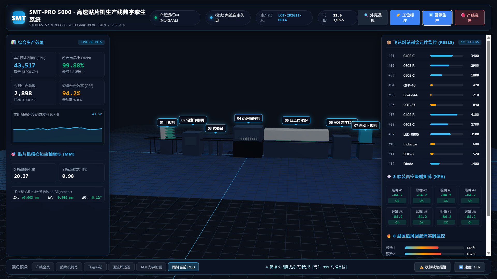

# 🏭 SMT High-Speed Pick & Place Production Line · Web 3D Digital Twin & Industrial SCADA Showcase

  <a href="README.md"><b>[ 简体中文 ]</b></a> &nbsp;|&nbsp; <b>[ English ]</b>

> Located at `siemens-s7-web-twin/examples/贴片机`, this example is a **production-grade industrial digital twin** developed strictly adhering to this project's standard architecture (I/O signal contracts, static/dynamic hierarchy, zero-clipping kinematics, multi-protocol gateway).

  
  
<em>▲ Live SCADA Dashboard & 3D Digital Twin for SMT High-Speed Production Line</em>

---

## 🌟 Key Features & Optimizations

1. **Seamless Dual Operating Modes**:
   - **Offline Autonomous Simulation Mode**: Double-click `index.html` to run immediately in your browser with zero server setup. Features 3-phase kinematics, real-time CPH waveform, vacuum telemetry, and interactive controls.
   - **Live Gateway Link Mode**: Double-click `start.bat` to launch the multi-protocol gateway (`tia_gateway.py`). The frontend connects via WebSocket (`tia-twin-client.js`) and reacts to live Siemens S7-1500/1200 PLC, Modbus, or simulator signals.
2. **Strict Zero-Clipping Kinematics & Physical Alignment**:
   - Conveyor rail elevation is rigidly locked at `Y = 2.40m` with a standardized 1.6m track width across all 7 stations.
   - The pick & place head moves horizontally at a designated safe height `Z_SAFE`; component pickup depth stops strictly at the feeder pocket surface; placement depth stops precisely at the PCB pad solder surface `Y_PAD = TRACK_Y + PCB_THICKNESS` (no penetration into PCB or table).
3. **Blender Procedural Industrial Modeling (`smt_blender_script.py`)**:
   - Adheres to the 6 industrial modeling hard rules:
     - Static structural extrusions merged to minimize Draw Calls (guaranteeing 120 FPS).
     - Hierarchical assembly tree: `SMT_Gantry_Y` -> `SMT_Head_X` -> `SMT_Nozzle_Array`.
     - Pivot origins aligned with physical actuator zero positions.
4. **Siemens TIA Portal SCL Source Code (`TwinIO.scl`)**:
   - Includes auto-generated SCL source files for non-optimized DB1 and control logic, ready for 1-click import into TIA Portal V16/V17/V18/V19.

---

## 📁 File Directory

| File | Description |
| :--- | :--- |
| [`index.html`](index.html) | Main Web 3D digital twin & SCADA application |
| [`app.js`](app.js) | Three.js rendering pipeline, FSM kinematics, and `tia-twin-client` integration |
| [`styles.css`](styles.css) | Industrial dark-mode glassmorphism HUD styles |
| [`twin.manifest.json`](twin.manifest.json) | Industrial I/O signal manifest (25 tags, 4-byte memory aligned for Siemens S7) |
| [`gateway.config.json`](gateway.config.json) | Local communication gateway configuration |
| [`TwinIO.scl`](TwinIO.scl) | Siemens TIA Portal SCL external source file for DB1 |
| [`smt_blender_script.py`](smt_blender_script.py) | Automated Blender 3.x/4.x modeling script with animation keyframes & GLB exporter |
| [`tia-twin-client.js`](tia-twin-client.js) | Zero-dependency WebSocket client library |
| [`start.bat`](start.bat) | 1-click startup script for gateway and browser |
| [`stop.bat`](stop.bat) | 1-click shutdown script |

---

## 🔌 Siemens S7 Data Block (DB1) Signal Table

Validated with `scripts/validate_manifest.py` (0 errors, 4-byte aligned):

| Tag ID | Address | Type | Access | Description |
| :--- | :--- | :--- | :--- | :--- |
| `cmd.start` | `DB1.DBX0.0` | Bool | RW (Pulse 200ms) | Start Line Command |
| `cmd.stop` | `DB1.DBX0.1` | Bool | RW (Pulse 200ms) | Stop Line Command |
| `cmd.reset` | `DB1.DBX0.2` | Bool | RW (Pulse 200ms) | Alarm Reset Command |
| `cmd.estop` | `DB1.DBX0.3` | Bool | RW (Pulse 200ms) | Emergency Stop Command |
| `smt.running` | `DB1.DBX0.4` | Bool | RW | Mounter Running Status (1=Run, 0=Stop) |
| `smt.paused` | `DB1.DBX0.5` | Bool | RW | Mounter Pause State |
| `smt.alarm_active` | `DB1.DBX0.6` | Bool | RW | General Alarm Active |
| `smt.xray_mode` | `DB1.DBX0.7` | Bool | RW | X-Ray Translucent Inspection Mode |
| `sens.infeed_pe` | `DB1.DBX1.0` | Bool | RW | Infeed Photoelectric Sensor (1=PCB present) |
| `sens.clamped` | `DB1.DBX1.1` | Bool | RW | PCB Clamping Cylinder Engaged |
| `sens.vision_ok` | `DB1.DBX1.2` | Bool | RW | Flying Vision Alignment Qualified |
| `sens.placed_ok` | `DB1.DBX1.3` | Bool | RW | Board Placement Completed |
| `sens.reflow_in` | `DB1.DBX1.4` | Bool | RW | Reflow Oven Infeed Sensor |
| `sens.aoi_result` | `DB1.DBX1.5` | Bool | RW | AOI Optical Inspection Result (1=OK, 0=NG) |
| `sens.outfeed_pe` | `DB1.DBX1.6` | Bool | RW | Outfeed Unloader Sensor |
| `smt.feeder_index` | `DB1.DBW2` | Int16 | RW | Active Feeder Slot Index (1-12) |
| `smt.axis_x` | `DB1.DBD4` | Real (4-byte aligned) | RW | X-Axis Placement Carriage Coordinate (mm) |
| `smt.axis_y` | `DB1.DBD8` | Real (4-byte aligned) | RW | Y-Axis Dual-Drive Gantry Coordinate (mm) |
| `smt.axis_z` | `DB1.DBD12` | Real (4-byte aligned) | RW | Z-Axis Nozzle Travel Depth (mm) |
| `smt.vacuum_kpa` | `DB1.DBD16` | Real (4-byte aligned) | RW | Active Nozzle Vacuum Pressure (kPa) |
| `smt.cph` | `DB1.DBD20` | Real (4-byte aligned) | RW | Placement Speed (Chips Per Hour) |
| `smt.yield_rate` | `DB1.DBD24` | Real (4-byte aligned) | RW | Overall Yield Rate (%) |
| `smt.total_count` | `DB1.DBD28` | Int32 (4-byte aligned) | RW | Daily Finished PCB Output (PCS) |
| `smt.reflow_temp_peak` | `DB1.DBD32` | Real (4-byte aligned) | RW | Reflow Oven Peak Zone Temperature (°C) |
| `smt.alarm_code` | `DB1.DBW36` | Int16 | RW | Alarm Code (0=None, 1=Empty Feeder, 2=Offset, 3=Thermal) |

---

## 🚀 How to Run

### Method 1: Instant Browser Launch (Offline Simulation)
- Double click [`index.html`](index.html).
- The top status bar will indicate `Mode: Autonomous Offline Simulation`.
- Includes full 3D kinematics, animated CPH waveform, vacuum readings, and real-time feeder stock countdown.

### Method 2: Launch Multi-Protocol Gateway (Live PLC / Simulator)
1. Double click [`start.bat`](start.bat).
2. The gateway starts and listens on `ws://127.0.0.1:8765`.
3. The browser opens automatically, switching the status badge to `Gateway Connected (S7/MODBUS)`.
4. To stop the service, double-click [`stop.bat`](stop.bat).

### Method 3: Blender 3D Modeling & Export
1. Launch **Blender 3.0+ / 4.0+**.
2. Switch to the **Scripting** tab and open [`smt_blender_script.py`](smt_blender_script.py).
3. Click **▶ Run Script** to generate the assembly and export `smt_line.glb`.
